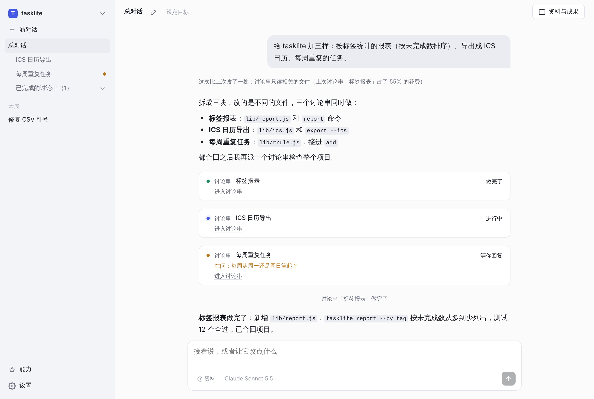
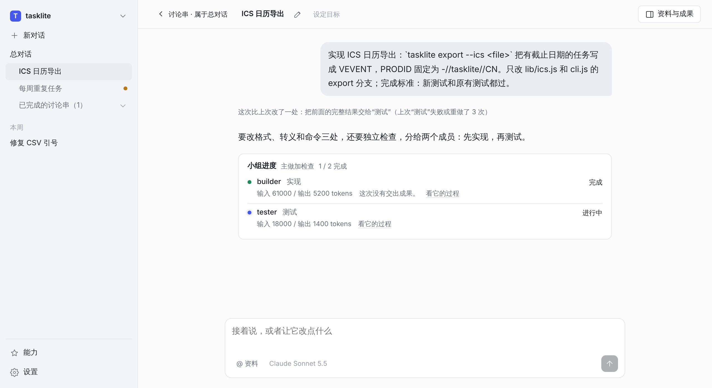

<div align="center">


### One project. A team that learns.

**A desktop agent that works in your project folder, organizes its own team, and remembers what worked.**

[](#)
[](https://nodejs.org/)
[](https://www.electronjs.org/)
[](LICENSE)

English | [中文](README_zh.md)

</div>

## Philosophy

**Improvement should happen inside the work you are already doing, not in an offline lab.**

You open a project folder and say what you want in plain words. A coordinator splits the work and hands each part to a thread, a background conversation that works in its own copy of the project and organizes its own members when its part is large. You can keep talking while it works. After each task it measures how the work was organized, changes the costliest part, and keeps the change only if the next similar tasks get better.

> **One project. A team that learns.**

---

## Design principles

1. **The user's words come first**  
   You can interrupt at any time; the next model request takes your message, and running members and members that start next get it too. Compaction keeps every word you said verbatim, so rules set at the start survive a long task. Project rules you state ("from now on…") are given on every task.

2. **The agent organizes the work**  
   Each project has one coordinator conversation. It does not edit files or run commands: it splits the task, hands every part to a thread, follows up, passes your corrections on and sums up. A thread works in the background in its own copy of the project; a small part it does and checks itself, a large one it splits into 1–6 members (plan, explore, implement, test, review) with one `organize` tool. Finished work merges back into the project, and the coordinator gets a whole-project check done when several threads merged. It keeps project notes (goals, standing rules, decisions, pitfalls) and briefs each thread with its goal, inputs and limits.

3. **It improves its own organization, quietly**  
   After every team task it measures each part (cost, time, failures, waiting, work thrown away), changes the hottest one, and keeps or reverts the change by the same numbers on the next similar tasks. Outcomes count, not self-praise: deterministic checks, your corrections and rework, an external reviewer and cost. A share of tasks always runs as a control. You see one line about what changed and one sentence about the effect; there are no settings for it.

4. **Generic, never task-specific**  
   No rule, prompt or default exists to make one kind of task pass. Example tasks are only used to measure.

5. **Recoverable and safe**  
   Sessions are append-only logs: stop, rewind file changes, or kill the process and resume. Commands run in an OS sandbox; writes outside the project need approval; spending has caps in dollars.

Full positioning: [`docs/PROJECT_POSITIONING.md`](docs/PROJECT_POSITIONING.md) and [`AGENTS.md`](AGENTS.md).

---

## System shape


```text
Desktop app (Electron + React)        CLI
              │                        │
              └──────── In-process SDK ┘
                          │
                          ▼
   Coordinator (project chat): split · start threads · relay · sum up
                          │
                          ▼
   Threads, each in its own project copy, merged back after each turn
                          │
                          ▼
   Kernel loop: queued user messages → model → tools → present → checks
        │                 │                      │
     Context          Organizer               Workspace
 rules · notes ·     solo / organize      OS sandbox · approvals
 practices ·         members: delegate      cost caps
 user's words        · workflow
                          │
                          ▼
   Session store (JSONL, ledger, snapshots)   Outcome memory
                          (organization library and reflection, practice handbook)
                          │
                          └──── feeds the next turn
```

---

## What is in this repository

| Path | Contents |
|---|---|
| `apps/desktop/` | Electron main process and React interface |
| `apps/cli/` | The `nexgent` command |
| `packages/kernel/` | Turn loop, tools, contracts (field names live in `src/contracts/`) |
| `packages/llm/` | Claude Platform route (Anthropic Messages API) |
| `packages/session/` | Session log, ledger, resume |
| `packages/workspace/` | Working directory, OS sandbox, command policy |
| `packages/context/` | Context, material references, compaction |
| `packages/tasking/` | Materials, deliverables, feedback, goals |
| `packages/subagent/`, `team/`, `workflow/`, `ptc/` | Delegation, mailbox and task-board state, `organize`, workflows and the organization profile, code execution |
| `packages/capabilities/`, `evolve/` | Practice handbook, project rules, organization library and coordinator reflection, outcome review; capability gate and skill library (off by default) |
| `packages/sdk/` | In-process API shared by the desktop app and the CLI |
| `packages/skill/`, `preset/`, `tool-spreadsheet/`, `web/` | Skills, presets, spreadsheet and web tools |
| `packages/test-support/`, `scripts/` | Scripted model, acceptance and measurement scripts |
| `reference/deepseek-harness/` | Read-only reference (submodule, not built) |
| `docs/` | Positioning, operation, configuration, specs ([index](docs/README.md)) |

---

## What it can do

- **Projects, conversations, materials, deliverables** — materials are copies; deliverables are versioned with diffs and per-version feedback
- **Interrupt while it works** — messages reach the model and running members on the next step, and members that start next
- **A coordinator per project** — pinned on top as the default entry; it splits work, follows threads and sums up
- **Threads** — background conversations with a card each (running / done / waiting for you / waiting for approval); open one to watch it or talk to it; finished ones fold away
- **Teams inside a thread** — only when its part is large; roles, parallel members, reorganize when stuck
- **Improves its own organization** — one line under your message says what it changed this time and why; the Capabilities page says how much cheaper and faster similar tasks got
- **Remembers good organizations** — per task class, compared against control runs
- **Project rules and practices** — rules on every task, asks when a rule conflicts with existing tests or code; practices kept or retired by randomized give/withhold
- **Checks itself** — tests, your check commands, deliverables that must open; fixes within the same turn
- **Stop, rewind, resume** — and approvals, sandboxing and cost caps

<p align="center"></p>
<p align="center"><sub>The coordinator split one request into three threads: one done, one running, one waiting for an answer. The grey line under the request is this time's change to the organization.</sub></p>

<p align="center"></p>
<p align="center"><sub>Inside a thread: its part was large enough for two members, a builder and then a tester. The interface is in Chinese; the data in both pictures is an example.</sub></p>

---

## Quick start

Requirements: Node.js 22.12+, pnpm 10.28.0, an Anthropic API key; on Windows also PowerShell 7.

```bash
git clone https://github.com/csxq0605/nexgent.git
cd nexgent
pnpm install --frozen-lockfile
pnpm build
pnpm --filter @nexgent/desktop build

export NEXGENT_API_KEY=<key>          # or paste it in Settings
pnpm --filter @nexgent/desktop start
```

Command line:

```bash
node apps/cli/bin/nexgent.mjs run --project <dir> --task "..."
```

Running from source and packaging: [Run locally](docs/RUN_LOCAL.md). Day-to-day use: [Operation manual](docs/OPERATION_MANUAL.md).

---

## Docs

| Purpose | Document |
|---|---|
| Operation manual | [docs/OPERATION_MANUAL.md](docs/OPERATION_MANUAL.md) |
| Run locally, package | [docs/RUN_LOCAL.md](docs/RUN_LOCAL.md) |
| Configuration | [docs/CONFIGURATION.md](docs/CONFIGURATION.md) |
| Product & design positioning | [docs/PROJECT_POSITIONING.md](docs/PROJECT_POSITIONING.md) |
| Repository rules (dev / agents) | [AGENTS.md](AGENTS.md) |
| Docs index | [docs/README.md](docs/README.md) |

---

## License

MIT. See [LICENSE](LICENSE).
