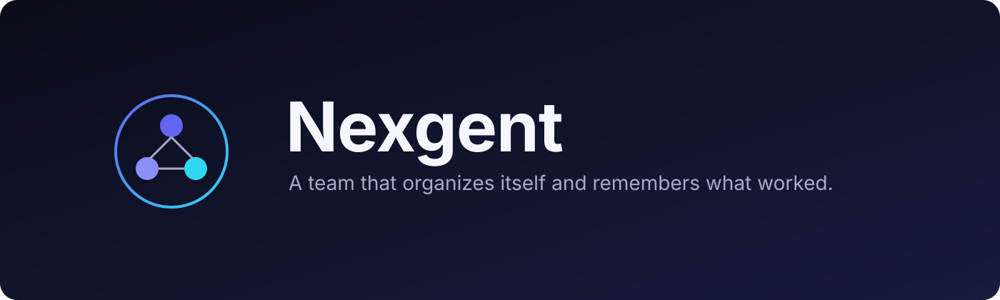
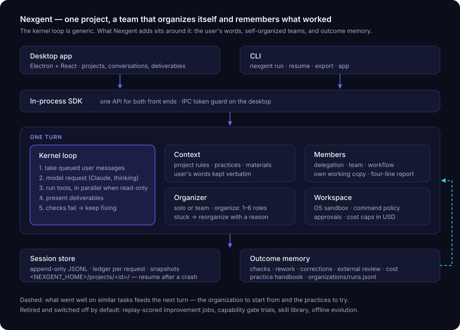
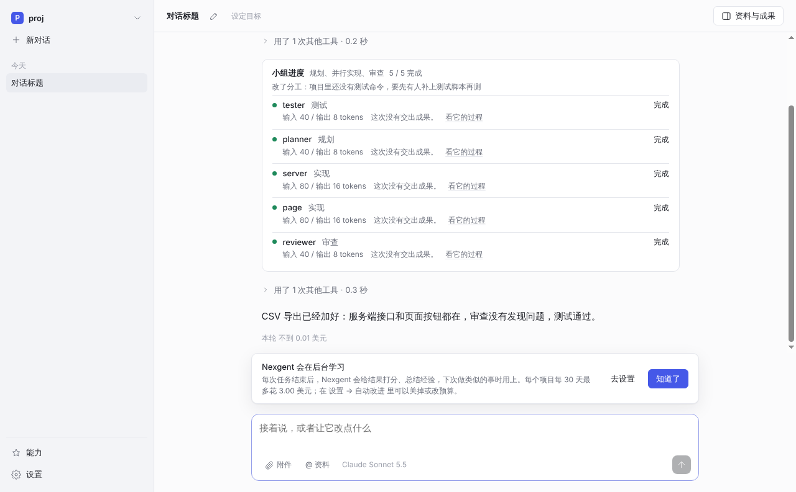

<div align="center">



### One project. A team that learns.

**A desktop agent that works in your project folder, organizes its own team, and remembers what worked.**

[](#)
[](https://nodejs.org/)
[](https://www.electronjs.org/)
[](LICENSE)

English | [中文](README_zh.md)

</div>

## Philosophy

**Improvement should happen inside the work you are already doing, not in an offline lab.**

You open a project folder, hand over materials, and say what you want in plain words. Nexgent reads, writes and runs commands in that folder and hands back deliverables. While it works you can keep talking to it; it remembers what you said, decides whether the task needs a team, and keeps a record of which ways of working went well on similar tasks so the next one starts from there.

> **One project. A team that learns.**

---

## Design principles

1. **The user's words come first**  
   You can interrupt at any time; the next model request takes your message, and running members get it too. Compaction keeps every word you said verbatim, so rules set at the start survive a long task. Project rules you state ("from now on…") are given on every task.

2. **The agent organizes the work**  
   Each project has one resident coordinator conversation. Small tasks are done alone. Larger ones get a team declared through one `organize` tool: 1–6 roles (plan, explore, implement, test, review), parallel where possible, each in its own working copy. When the team stalls, it reorganizes and says why. After every team task the coordinator reflects on its own, without waiting for feedback: it measures each part (cost, time, failures and retries, waiting, work later thrown away), changes the organization at the hottest part only, and keeps or reverts that change by the same measures on the next similar tasks.

3. **Outcomes, not self-praise**  
   What counts is deterministic checks, your corrections and rework, an external reviewer and cost. A model never scores its own run. A share of tasks always runs solo as a control.

4. **Generic, never task-specific**  
   No rule, prompt or default exists to make one kind of task pass. Example tasks are only used to measure.

5. **Recoverable and safe**  
   Sessions are append-only logs: stop, rewind file changes, or kill the process and resume. Commands run in an OS sandbox; writes outside the project need approval; spending has caps in dollars.

Full positioning: [`docs/PROJECT_POSITIONING.md`](docs/PROJECT_POSITIONING.md) and [`AGENTS.md`](AGENTS.md).

---

## System shape



```text
Desktop app (Electron + React)        CLI
              │                        │
              └──────── In-process SDK ┘
                          │
                          ▼
   Kernel loop: queued user messages → model → tools → present → checks
        │                 │                      │
     Context          Organizer               Workspace
 rules · practices   solo / organize      OS sandbox · approvals
  user's words       members: delegate      cost caps
                     · workflow
                          │
                          ▼
   Session store (JSONL, ledger, snapshots)   Outcome memory
                                    (practice handbook, organization library)
                          │
                          └──── feeds the next turn
```

---

## What is in this repository

| Path | Contents |
|---|---|
| `apps/desktop/` | Electron main process and React interface |
| `apps/cli/` | The `nexgent` command |
| `packages/kernel/` | Turn loop, tools, contracts (field names live in `src/contracts/`) |
| `packages/llm/` | Claude Platform route (Anthropic Messages API) |
| `packages/session/` | Session log, ledger, resume |
| `packages/workspace/` | Working directory, OS sandbox, command policy |
| `packages/context/` | Context, material references, compaction |
| `packages/tasking/` | Materials, deliverables, feedback, goals |
| `packages/subagent/`, `team/`, `workflow/`, `ptc/` | Delegation, mailbox and task-board state, `organize`, workflows and the organization profile, code execution |
| `packages/capabilities/`, `evolve/` | Practice handbook, project rules, organization library and coordinator reflection, outcome review; capability gate and skill library (off by default) |
| `packages/sdk/` | In-process API shared by the desktop app and the CLI |
| `packages/skill/`, `preset/`, `tool-spreadsheet/`, `web/` | Skills, presets, spreadsheet and web tools |
| `packages/test-support/`, `scripts/` | Scripted model, acceptance and measurement scripts |
| `reference/deepseek-harness/` | Read-only reference (submodule, not built) |
| `docs/` | Positioning, operation, configuration, specs ([index](docs/README.md)) |

---

## What it can do

- **Projects, conversations, materials, deliverables** — materials are copies; deliverables are versioned with diffs and per-version feedback
- **Interrupt while it works** — messages reach the model and running members on the next step
- **A coordinator conversation per project** — pinned on top as the default entry
- **Self-organized teams** — roles, parallel members, reorganize when stuck
- **Improves its own organization** — after each team task it measures every part, changes the hottest one, and keeps or reverts the change on the next similar tasks; the team card says in one line what changed and why
- **Remembers good organizations** — per task class, compared against solo runs, shown as one sentence on the Capabilities page (with the change since the first similar tasks once there are enough)
- **Project rules and practices** — rules on every task, asks when a rule conflicts with existing tests or code; practices kept or retired by randomized give/withhold
- **Checks itself** — tests, your check commands, deliverables that must open; fixes within the same turn
- **Stop, rewind, resume** — and approvals, sandboxing and cost caps

Every item has scripted-model tests. The new mechanisms (interrupting, teams, organization memory) have only had a small real-model trial on macOS; the coordinator's reflection has scripted-model tests only. Their effect still needs more everyday tasks.

<p align="center"></p>

---

## Quick start

Requirements: Node.js 22.12+, pnpm 10.28.0, an Anthropic API key; on Windows also PowerShell 7.

```bash
git clone https://github.com/csxq0605/nexgent.git
cd nexgent
pnpm install --frozen-lockfile
pnpm build
pnpm --filter @nexgent/desktop build

export NEXGENT_API_KEY=<key>          # or paste it in Settings
pnpm --filter @nexgent/desktop start
```

Command line:

```bash
node apps/cli/bin/nexgent.mjs run --project <dir> --task "..."
```

Running from source and packaging: [Run locally](docs/RUN_LOCAL.md). Day-to-day use: [Operation manual](docs/OPERATION_MANUAL.md).

---

## Docs

| Purpose | Document |
|---|---|
| Operation manual | [docs/OPERATION_MANUAL.md](docs/OPERATION_MANUAL.md) |
| Run locally, package | [docs/RUN_LOCAL.md](docs/RUN_LOCAL.md) |
| Configuration | [docs/CONFIGURATION.md](docs/CONFIGURATION.md) |
| Product & design positioning | [docs/PROJECT_POSITIONING.md](docs/PROJECT_POSITIONING.md) |
| Repository rules (dev / agents) | [AGENTS.md](AGENTS.md) |
| Docs index | [docs/README.md](docs/README.md) |

Earlier history, including the archived Python product, is in [csxq0605/Nexgent-archive](https://github.com/csxq0605/Nexgent-archive).

---

## License

MIT. See [LICENSE](LICENSE).
