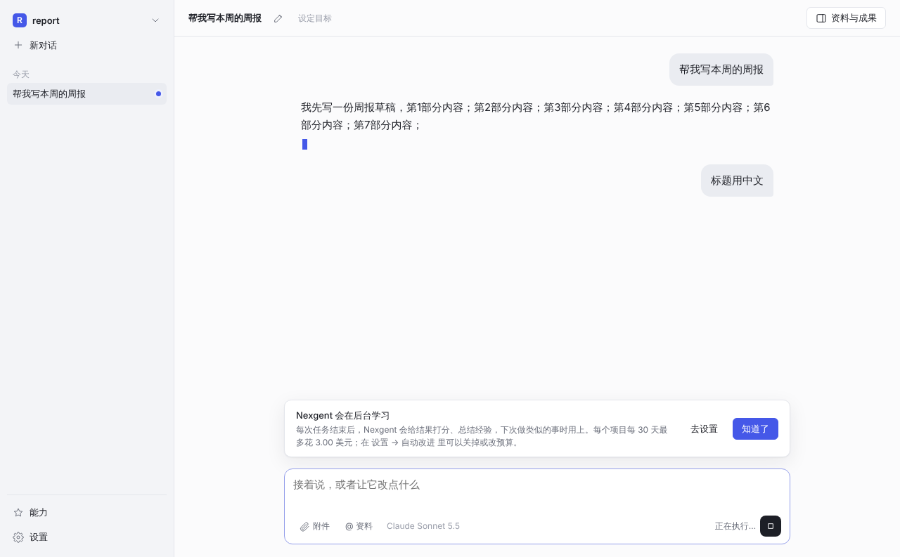

<div align="center">


### One project. A team that learns.

**在你的项目文件夹里干活、自己组队、记住什么做法有效的桌面智能体**

[](#)
[](https://nodejs.org/)
[](https://www.electronjs.org/)
[](LICENSE)

[English](README.md) | 中文

</div>

## 理念

Nexgent 的出发点是：**改进应该发生在你手上正在做的事情里，而不是在离线的实验室里。**

你打开一个项目文件夹，用平常的话说想要什么。协调者把活拆开，每一块交给一个讨论串：讨论串是在后台、在自己的项目副本里干活的对话，那一块大时它自己再派成员。它干活时你可以随时插话。每次做完，它量一量这次是怎么组织的，改最费的一处，只有下一次同类任务变好了才留下。

> **One project. A team that learns.**

---

## 设计原则

1. **用户的话优先**  
   随时可以插话，下一次模型请求就带上，正在干活和接着开始的成员也会收到。压缩上下文时你说过的原话逐字保留，长任务里开头定的约定不会丢。你说过“以后都要这样”的项目规则，每次任务都给。

2. **由智能体组织工作**  
   每个项目有一个总对话（协调者）。它不改文件、不跑命令，只拆分任务、把每一块交给一个讨论串、跟进、转达你的纠正、汇总结果。讨论串在后台、在自己的项目副本里干活：小的一块自己做、自己查，大的用一个 `organize` 工具分给 1–6 个成员（规划、调查、实现、测试、审查）。做完的改动合回项目，几个讨论串都合回后协调者会安排一次整个项目的检查。协调者维护项目笔记（长期目标、长期规则、决定、坑），派讨论串时写清目标、输入和不许碰的东西。

3. **安静地改进自己的组织**  
   每次组队做完，量出每一部分的花费、耗时、失败、空等和白做的活，改最热的一处，下一次同类任务用同样的数决定留下还是退回。算数的是结局，不是自夸：确定性检查、你的纠正与返工、外部评审和花费；始终留一部分任务作对照。你看到的只是一行“这次改了什么”和一句效果，没有相关设置。

4. **通用，不为某类任务特化**  
   不为让某类任务通过而写规则、提示或默认值；案例只用来测量。

5. **可恢复、安全**  
   会话是只追加的记录：可以停止、撤回文件改动，进程被强杀后接着聊。命令在系统沙箱里跑，写项目外的文件要你批准，花费有美元上限。

完整定位见 [`docs/PROJECT_POSITIONING.md`](docs/PROJECT_POSITIONING.md) 与 [`AGENTS.md`](AGENTS.md)。

---

## 系统形态


```text
桌面应用（Electron + React）          命令行
              │                        │
              └────── 进程内 SDK ───────┘
                          │
                          ▼
   协调者（总对话）：拆分 · 派讨论串 · 转达 · 汇总
                          │
                          ▼
   讨论串：各自在项目副本里干活，每轮结束合回项目
                          │
                          ▼
   内核循环：收进插话 → 模型请求 → 工具 → 交付成果 → 完成检查
        │                 │                      │
      上下文            组织者                  工作区
 规则 · 笔记 · 经验   单独做 / organize      系统沙箱 · 审批
   用户原话           成员：委派 · 工作流       费用上限
                          │
                          ▼
   会话存储（JSONL、账本、快照）           结局记忆
                                （组织库与复盘、经验手册）
                          │
                          └──── 用到下一轮
```

---

## 仓库内容

| 路径 | 内容 |
|---|---|
| `apps/desktop/` | Electron 主进程与 React 界面 |
| `apps/cli/` | `nexgent` 命令 |
| `packages/kernel/` | 一轮对话的循环、工具、契约（字段名以 `src/contracts/` 为准） |
| `packages/llm/` | Claude Platform 接入（Anthropic Messages API） |
| `packages/session/` | 会话记录、账本、恢复 |
| `packages/workspace/` | 工作区、系统沙箱、命令策略 |
| `packages/context/` | 上下文、资料引用、压缩 |
| `packages/tasking/` | 资料、成果、反馈、目标 |
| `packages/subagent/`、`team/`、`workflow/`、`ptc/` | 委派、信箱与任务板状态、`organize`、工作流与组织画像、代码执行 |
| `packages/capabilities/`、`evolve/` | 经验手册、项目规则、组织库与协调者复盘、结局评审；以及默认关闭的门控和技能库 |
| `packages/sdk/` | 桌面应用与命令行共用的进程内接口 |
| `packages/skill/`、`preset/`、`tool-spreadsheet/`、`web/` | 技能、预设、表格与网页工具 |
| `packages/test-support/`、`scripts/` | 脚本化模型、验收与测量脚本 |
| `reference/deepseek-harness/` | 只读参考（子模块，不参与构建） |
| `docs/` | 定位、操作、配置、规范（[索引](docs/README.md)） |

---

## 能做什么

- **项目、对话、资料、成果** —— 资料是副本，原文件不动；成果带版本，可看差异、针对某一版提修改
- **干活时随时插话** —— 下一步就生效，正在跑和接着开始的成员也收到
- **每个项目一个协调者** —— 总对话置顶，是默认入口；拆分、跟进讨论串、汇总
- **讨论串** —— 后台对话，每个一张卡片（进行中 / 做完了 / 等你回复 / 等你批准）；可以进去看、直接跟它说话；做完的收起来
- **讨论串里组队** —— 只在那一块大时；按角色分工、并行，卡住时改组
- **自己改进组织** —— 你的消息下面一行说这次改了什么、为什么；能力页说同类任务比一开始省了多少、快了多少
- **记住好的分工** —— 按任务类别，和对照比较
- **项目规则与经验** —— 规则每次都给，与现有测试或代码冲突时先问你；经验靠随机给与不给的对照决定留不留
- **自己检查** —— 测试、你设的检查命令、交付的文件要能打开；没过就在同一轮里接着改
- **停止、撤回、恢复** —— 以及审批、沙箱和费用上限

每一项都有脚本化模型的自动测试。真实模型目前只小规模试过（macOS 与云端）：协调者会拆成讨论串、纠正能转到对的讨论串、提示缓存能跨轮命中。复盘后的改法“留下”还没在真实任务里出现过，效果要更多日常任务来确认。

<p align="center"></p>

---

## 快速开始

需要 Node.js 22.12+、pnpm 10.28.0、一个 Anthropic API 密钥；Windows 还需要 PowerShell 7。

```bash
git clone https://github.com/csxq0605/nexgent.git
cd nexgent
pnpm install --frozen-lockfile
pnpm build
pnpm --filter @nexgent/desktop build

export NEXGENT_API_KEY=<key>          # 也可以在设置页填写
pnpm --filter @nexgent/desktop start
```

命令行：

```bash
node apps/cli/bin/nexgent.mjs run --project <dir> --task "..."
```

从源码运行与打包见 [本地运行](docs/RUN_LOCAL.md)，日常使用见 [操作手册](docs/OPERATION_MANUAL.md)。

---

## 文档

| 用途 | 文档 |
|---|---|
| 操作手册 | [docs/OPERATION_MANUAL.md](docs/OPERATION_MANUAL.md) |
| 本地运行与打包 | [docs/RUN_LOCAL.md](docs/RUN_LOCAL.md) |
| 配置 | [docs/CONFIGURATION.md](docs/CONFIGURATION.md) |
| 产品与设计定位 | [docs/PROJECT_POSITIONING.md](docs/PROJECT_POSITIONING.md) |
| 仓库约定（开发 / 智能体） | [AGENTS.md](AGENTS.md) |
| 文档索引 | [docs/README.md](docs/README.md) |

更早的开发历史（含已归档的 Python 旧产品）在 [csxq0605/Nexgent-archive](https://github.com/csxq0605/Nexgent-archive)。

---

## License

MIT，见 [LICENSE](LICENSE)。
